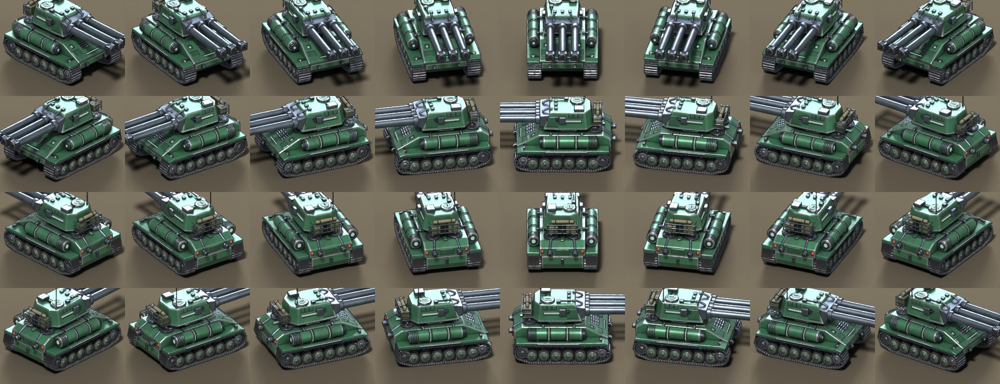
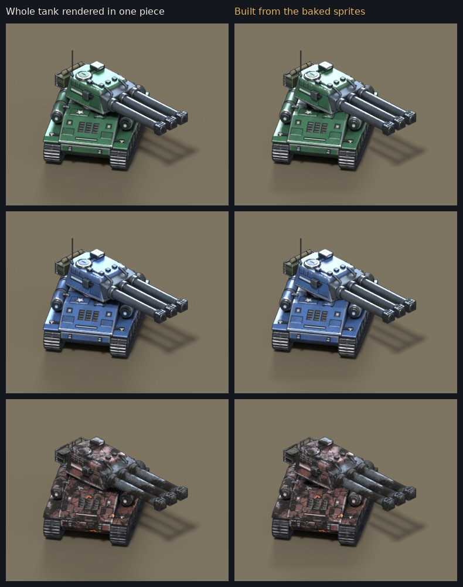

# Tanks — 3D models rendered to sprites

**Status (2026-11-20): the three Panzer tanks (Light, Medium, Heavy hull + Panzer turret) are modelled and approved, and their
sprites are baked, packed and checked on the PC.** The other four weapon types are not modelled yet.
Roster, weapons and roles: [`../tank-types.md`](../tank-types.md). Rules for every asset: [`../../CLAUDE.md`](../../CLAUDE.md).
Full design note with every decision and measurement: [`tanks-3d-model.md`](tanks-3d-model.md).

Damage states (intact, damaged, burning, wreck):

All 32 directions (Heavy; Light and Medium are in `images/`):

Test bake check, 2026-11-20: the whole tank rendered in one piece (left) against the tank rebuilt from the baked sprites (right):

## What is in this folder

| Path | What it is |
|---|---|
| `tanks-3d-model.md` | The design note: plan, the owner's decisions, the four mockup passes, the built model, the bake (section 18), handover (section 19) |
| `images/` | Renders and checks shown above |
| `source/tank_lib.py` | The model: chassis, Panzer turret, layers, damage, track frames. **Source of truth.** |
| `source/sow_common.py` | Code shared with the walkers (colours, materials, lights, the game's camera, render setup), cut from `walker_lib.py` |
| `source/bake_tanks.py`, `source/bake_panzer.bat` | The bake: renders every sprite frame into `bake/` |
| `source/tools/pack_tanks.py` | Packs `bake/` into WebP sheets + `tanks.json` (@4x, @2x, @1x) |
| `source/tools/compose_tanks.py` | Rebuilds tanks from the sheets the way the game will |
| `source/tools/check_refs.py`, `check_pack.py` | The pack check: whole renders against tanks built from the sheets |
| `source/build_tanks.py`, `source/blend/`, `source/tank_data.json` | Builds and saves the three `.blend` scenes (Blender 5.3); model data in metres |
| `source/mockup/` | The scripts behind the mockup boards, for round 2 |
| `source/README.md` | How to use the files above, command by command |
| `demo/` | The tank demo page (PixiJS): tanks driving, turrets aiming, team colours, damage states, drawn from the packed sheets in `source/sheets/`. Start it with `demo/run_demo.bat` (needs Node.js and the internet for PixiJS) |
| `vector-viewer/` | The approved vector tanks (the design reference the 3D models follow) |

**Not in the repo:** the bake frames (`bake/`, 3,120 PNG, ignored by git) and the packed sheets. Where the sheets live is not decided
(the walker sheets are not in the repo either). Work copy of `source/` on the owner's PC:
`C:\Users\khala\Desktop\temp\Game Dev\StateOfWar-Tanks` (identical on 2026-11-20).

## How the tanks are made
- Each tank is built by Python in Blender from the same formulas as the vector model, then rendered with Cycles in the game's 2:1 view.
- **Hull and turret are separate sprites**, split by a flat plane at the turret pivot height, 32 directions each.
- **Hull:** 32 directions × 4 track frames × 3 states (intact, damaged, burning). **Turret:** 32 directions × 3 states.
  **Ground shadows:** one for the hull and one for the turret per direction (blend with "max"). **Wreck:** one merged sprite, 16 directions.
- **Team mask:** each hull and turret frame is rendered twice. A = paint black, team lights off. B = paint red, lights green, at 20%
  brightness (`MASK_GAIN = 0.2`). The packer computes the mask as (B − A) / 0.2 and moves the part above 1.0 (paint highlights) into
  the base sprite. The game's colour formula is unchanged (see `CLAUDE.md`).
- **Each layer is rendered with a stand-in for the other** (`tank_lib.turret_proxies`): the hull with a plain round drum where the turret
  stands, so the deck is shaded the same for every turret direction; the turret over a dark disc at deck height. The camera sees
  neither. The tank is never moved for a render (the paint's dust depends on real height); the camera moves instead.
- **Not baked:** the barrels' shadow on the hull (it depends on the turret direction).
- **Track frames are stored as overlays (owner, 2026-11-20):** `--tracks overlay` (default) stores frame 0 as a whole hull and frames
  1–3 as small overlays with only the pixels that change; `--tracks full` stores four whole hulls (estimated at about 74 MB for all
  three resolutions, not packed). The game draws hull frame 0, then the overlay.

## Done on the PC (2026-11-20)
- **Bake:** `bake_panzer.bat`, 3,120 renders with Blender 5.3 on the RTX 3060 (GPU), 173 minutes, about 3.3 s per render.
- **Pack:** overlay tracks, 1,680 sprites in 17 sheets, 48.0 MB (@4x 33.1 MB, @2x 11.2 MB, @1x 3.7 MB), `tanks.json` 283 KB. The
  overlays hold 24% of the hull pixels they replace.
- **Check:** `check_refs.py` then `check_pack.py`: mean difference on the tank 6.7–9.5 of 255 over nine cases (expected 6–9; above
  about 12 means a fault).
- **Python:** the PC has no Python of its own. The pack tools ran from `source/.venv`, made from Blender's Python
  (`python -m venv --system-site-packages`) with Pillow installed; it is not in the repo.

## Next steps (in this order)
1. **Decide with the owner** where the sheets live. For now they are in `source/sheets/` on the PC, ignored by git.
2. Ask the owner which comes first:
   - **Mockup round 2:** Artillery, Anti-Air, Flamer and Special on all three sizes (mockup first, then model, then bake).
   - **Walkers:** re-bake with the new mask method, change their damaged look to the tank style (smoky tint, less orange / fire
     colour), plus other improvements the owner wants inside the walker models (not listed yet: ask). See `../walkers/README.md`.

## The owner's notes so far (keep to them)
- Added detail must be big enough to read at game size (thick pipes, for example). Less detail on the Light.
- Simple barrels; a smaller but more detailed muzzle brake (the owner calls it "the nozzle").
- No pipe on top of the Light's body.
- Burning: few orange spots, more black and smoky tinted areas, cracked plates.
- Sprite files must balance quality and size, with the web version in mind.
