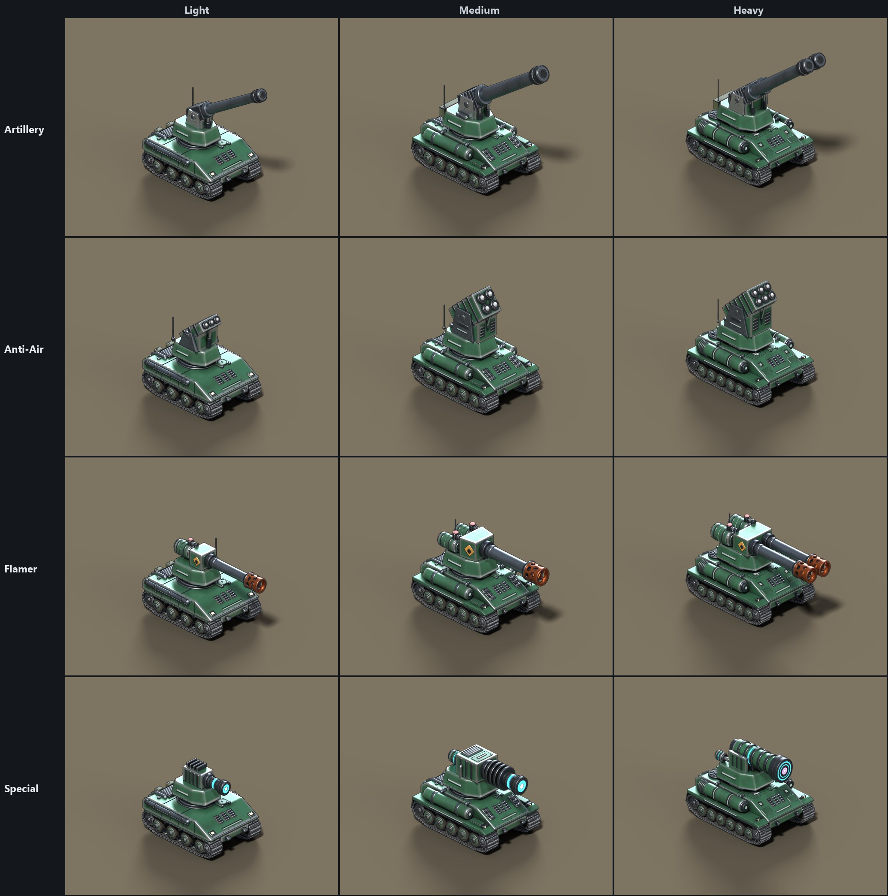

# Tanks — 3D models rendered to sprites

**Status (2026-11-20): the three Panzer tanks (Light, Medium, Heavy hull + Panzer turret) are modelled and approved, and their
sprites are baked, packed and checked on the PC. The other four weapon types (Artillery, Anti-Air, Flamer, Special) passed mockup
round 2 and are modelled on the same three hulls (12 `.blend` scenes); the owner approved the models on 2026-11-20. Their
turrets, turret shadows and wrecks were baked, packed and checked on the PC on 2026-11-20.**
Roster, weapons and roles: [`../tank-types.md`](../tank-types.md). Rules for every asset: [`../../CLAUDE.md`](../../CLAUDE.md).
Full design note with every decision and measurement: [`tanks-3d-model.md`](tanks-3d-model.md).

Damage states (intact, damaged, burning, wreck):

All 32 directions (Heavy; Light and Medium are in `images/`):

Test bake check, 2026-11-20: the whole tank rendered in one piece (left) against the tank rebuilt from the baked sprites (right):

The round 2 models (2026-11-20), each rendered from its saved `.blend` scene:

## What is in this folder

| Path | What it is |
|---|---|
| `tanks-3d-model.md` | The design note: plan, the owner's decisions, the four mockup passes, the built model, the bake (section 18), handover (section 19) |
| `images/` | Renders and checks shown above |
| `source/tank_lib.py` | The model: chassis, the five turrets (Panzer, Artillery, Anti-Air, Flamer, Special), layers, damage, track frames. **Source of truth.** |
| `source/sow_common.py` | Code shared with the walkers (colours, materials, lights, the game's camera, render setup), cut from `walker_lib.py` |
| `source/bake_tanks.py`, `source/bake_panzer.bat` | The bake: renders every sprite frame into `bake/` |
| `source/tools/pack_tanks.py` | Packs `bake/` into WebP sheets + `tanks.json` (@4x, @2x, @1x) |
| `source/tools/compose_tanks.py` | Rebuilds tanks from the sheets the way the game will |
| `source/tools/check_refs.py`, `check_pack.py` | The pack check: whole renders against tanks built from the sheets |
| `source/build_tanks.py`, `source/blend/`, `source/tank_data.json` | Builds and saves the `.blend` scenes (Blender 5.3), one per tank: 3 Panzer + 12 round 2; model data in metres |
| `source/mockup/` | The scripts behind the mockup boards (`mock.py` round 1, `mock2.py` round 2) |
| `source/README.md` | How to use the files above, command by command |
| `demo/` | The tank demo page (PixiJS): all 15 tanks driving, turrets aiming, a weapon filter, team colours, damage states, drawn from the packed sheets in `source/sheets/`. Since 2026-11-21 also the effects and sounds mockup: firing, hits, smoke, flames, explosions, a small battle (`fx.js`, `sfx.js`). Start it with `demo/run_demo.bat` (needs Node.js and the internet for PixiJS) |
| `tank-fx-design.md` | Effects and sounds for the tanks: the proposal behind the mockup (how each weapon shoots, the effects, the sounds, questions for the owner). **Approved by the owner on 2026-11-21**; a few points stay open (listed in its section 4) |
| `source/sheets/` | The packed sheets: 46 WebP files and `tanks.json` (93 MB). In the repo since 2026-11-21 (owner's decision) |
| `vector-viewer/` | The approved vector tanks (the design reference the 3D models follow) |

**Not in the repo:** the bake frames (`bake/`, 6,000 PNG with round 2, ignored by git). The walker sheets are not in the repo
yet (they will be re-baked first). Work copy of `source/` on the owner's PC:
`C:\Users\khala\Desktop\temp\Game Dev\StateOfWar-Tanks` (identical on 2026-11-20).

## How the tanks are made
- Each tank is built by Python in Blender from the same formulas as the vector model, then rendered with Cycles in the game's 2:1 view.
- **Hull and turret are separate sprites**, split by a flat plane at the turret pivot height, 32 directions each.
- **Hull:** 32 directions × 4 track frames × 3 states (intact, damaged, burning). **Turret:** 32 directions × 3 states.
  **Ground shadows:** one for the hull and one for the turret per direction (blend with "max"). **Wreck:** one merged sprite, 16 directions.
- **Team mask:** each hull and turret frame is rendered twice. A = paint black, team lights off. B = paint red, lights green, at 20%
  brightness (`MASK_GAIN = 0.2`). The packer computes the mask as (B − A) / 0.2 and moves the part above 1.0 (paint highlights) into
  the base sprite. The game's colour formula is unchanged (see `CLAUDE.md`).
- **Each layer is rendered with a stand-in for the other** (`tank_lib.turret_proxies`): the hull with a plain round drum where the turret
  stands, so the deck is shaded the same for every turret direction; the turret over a dark disc at deck height. The camera sees
  neither. The tank is never moved for a render (the paint's dust depends on real height); the camera moves instead.
- **Not baked:** the barrels' shadow on the hull (it depends on the turret direction).
- **Track frames are stored as overlays (owner, 2026-11-20):** `--tracks overlay` (default) stores frame 0 as a whole hull and frames
  1–3 as small overlays with only the pixels that change; `--tracks full` stores four whole hulls (estimated at about 74 MB for all
  three resolutions, not packed). The game draws hull frame 0, then the overlay.

## Done on the PC (2026-11-20)
- **Bake:** `bake_panzer.bat`, 3,120 renders with Blender 5.3 on the RTX 3060 (GPU), 173 minutes, about 3.3 s per render.
- **Pack:** overlay tracks, 1,680 sprites in 17 sheets, 48.0 MB (@4x 33.1 MB, @2x 11.2 MB, @1x 3.7 MB), `tanks.json` 283 KB. The
  overlays hold 24% of the hull pixels they replace.
- **Check:** `check_refs.py` then `check_pack.py`: mean difference on the tank 6.7–9.5 of 255 over nine cases (expected 6–9; above
  about 12 means a fault).
- **Python:** the PC has no Python of its own. The pack tools ran from `source/.venv`, made from Blender's Python
  (`python -m venv --system-site-packages`) with Pillow installed; it is not in the repo.

## Round 2: Artillery, Anti-Air, Flamer, Special (2026-11-20)
- **Mockup approved by the owner** on the design canvas "Tanks mockup round 2": https://claude.ai/artifact/E4pUrys3nWiuciVyFfD88c
- **Same hulls as the Panzer.** Only the turret differs, so the hull sprites, hull shadows and track overlays are already baked;
  round 2 needs the turret, its shadow and the wreck.
- **Artillery:** one long barrel raised 30 to 36 degrees on a cradle with cheek plates and rams (Heavy: two barrels), round muzzle brake.
- **Anti-Air:** a ribbed launcher block raised 38 to 42 degrees: Light 3 tubes, Medium 2 × 2, Heavy 2 × 3.
- **Flamer (owner's notes):** a long plain barrel; only the nozzle is a hollow sleeve with round holes cut through it (like a drilled
  part), the burner glows inside. Gas bottles on the back with a short feed pipe into the housing. **No pipes over the roof or on
  the barrel** (tried and refused). A first try with a wide drilled shroud over half the barrel was refused: it looked like a laser.
- **Special:** energy weapons with fixed cyan glows.
- **Model step done and approved by the owner:** `blender -b --python build_tanks.py -- artillery antiair flamer special` saved the
  12 scenes; the split check is 0 mm on every tank.
- **Owner's decisions (2026-11-20):** the Artillery barrel stays long; Artillery and Anti-Air are baked at one fixed raised angle;
  the Flamer burner and the Special lens glow all the time (baked into the sprite; the firing effects are still undecided); more
  detail on the plain areas, added and approved: Anti-Air Medium and Heavy have a team light strip, an inset plate and bolts on each
  cheek plate and two slatted vents on the front of the mount; Special Medium has a cooling grille and a bolted access panel with a
  team light on the housing roof.
- **Bake:** `bake_round2.bat`, or per weapon `blender -b --python bake_tanks.py -- --weapon flamer --only turret,shadow,wreck`.
  It bakes into the same `bake/` folder as the Panzer: 240 renders per tank (192 turret, 32 turret shadow, 16 wreck), 2,880 in all.
  The fixed glows stay in the base sprite and out of the team mask. `pack_tanks.py` already makes one sheet group per weapon.
- **Test bake (2026-11-20):** Heavy Flamer, direction 2, 9 sprites, 4.7 s each on the GPU, pictures checked by eye. At that speed
  the full round 2 bake was estimated at about 4 hours.
- **Full bake done (2026-11-20):** 2,880 renders in 134 minutes (Artillery 28, Anti-Air 35, Flamer 41, Special 30), 1.5 to 3.4 s
  each on the GPU. Every tank has its 192 turret, 32 turret shadow and 16 wreck frames; a sample of each weapon and size was
  checked by eye. 
- **Pack (2026-11-20, all 15 tanks):** `pack_tanks.py bake sheets`, overlay tracks, 46 sheets, 97.2 MB (@4x 67.6 MB, @2x 22.3 MB,
  @1x 7.3 MB), `tanks.json` 641 KB. Each weapon has its own two sheet groups (`tank-<weapon>`, `tank-<weapon>-dmg`), so a weapon
  loads only when it is needed; the hull sheets are shared.
- **Check (2026-11-20):** `check_refs.py --weapon <name> --out check_refs_<name>` then `check_pack.py` for each new weapon, nine
  cases each. Worst mean difference on the tank: Artillery 8.5, Anti-Air 8.3, Flamer 8.5, Special 9.0 of 255 (all 36 cases
  between 5.3 and 9.0; above about 12 means a fault). Pictures checked by eye.
- **Demo (2026-11-20):** the tank demo page shows all five weapons (a Weapon row: Mixed or one type). It loads each sheet the first
  time a tank needs it and draws up to 16 sheets per draw call; tanks that need more go into further calls in depth order.
  Measured with 300 mixed tanks in every damage state: 1 draw call at @1x and @2x, 6 at @4x (19 sheets in use there); shadows
  always 1. Checked in the app's browser pane; not yet tried by the owner in their own browser.

## Next steps (in this order)
1. **Where the sheets live: decided (owner, 2026-11-21): in the repo**, in `source/sheets/`. A new pack replaces the files there.
2. **Round 2 tanks** (the owner chose these first): baked, packed, checked and in the demo page. Open: the Flamer flame jet and Special beam
   effects are not decided.
3. **Tank effects and sounds (owner, 2026-11-21: before the walkers):** design in `tank-fx-design.md`, mockup in the demo
   page. **Approved on 2026-11-21.** Next, when the owner says so: bake the flipbooks into the real `fx` sheet and move the effects
   and sounds into the game.
4. Then the **Walkers:** re-bake with the new mask method, change their damaged look to the tank style (smoky tint, less orange / fire
     colour), plus other improvements the owner wants inside the walker models (not listed yet: ask). See `../walkers/README.md`.

## The owner's notes so far (keep to them)
- Added detail must be big enough to read at game size (thick pipes, for example). Less detail on the Light.
- Simple barrels; a smaller but more detailed muzzle brake (the owner calls it "the nozzle").
- No pipe on top of the Light's body.
- Burning: few orange spots, more black and smoky tinted areas, cracked plates.
- Sprite files must balance quality and size, with the web version in mind.
