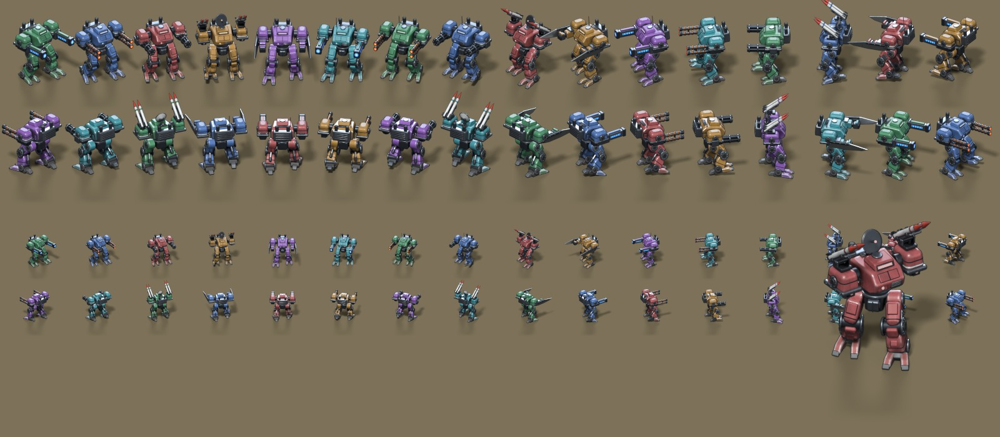

# Walkers — 3D models rendered to sprites

**Status (2026-11-19): approved, baked and packed into sprite sheets.** Not yet used by the game (see "Open" at the end).
Roster, weapons, ranges and roles: [`../walker-types.md`](../walker-types.md). Rules for every asset: [`../../CLAUDE.md`](../../CLAUDE.md).

| Kodiak | Cougar | Gatling | A.A. Avenger | Achilles |
|---|---|---|---|---|
|  |  |  |  |  |

Walk cycle (Kodiak, direction 2, 8 frames; legs, upper body with its per-frame offset, and the legs shadow):

Checks rebuilt from the packed sheets (all five walkers, team colours, directions; states and wrecks):

## What is in this folder

| Path | What it is |
|---|---|
| `images/` | Renders and checks shown above (JPG, small copies for the docs) |
| `source/walker_lib.py` | The whole model, renderer and bake functions: **source of truth** (md5 `2f2f0ee42681f45e7d33b6bb65db62be`) |
| `source/blend/walker_<kind>.blend` | One saved Blender scene per walker (Blender 5.3) |
| `source/tools/pack.py` | Packs the bake frames into sprite sheets + `walkers.json` (Python, numpy, Pillow) |
| `source/tools/compose.py` | Rebuilds units from the sheets, to check them |
| `source/listener.py`, `source/run_job.sh` | The bridge used to run jobs inside Blender on the PC (see "Bridge") |

**Not in the repo:** the bake frames (`bake/`, 3,336 PNG at @4x, 234 MB) and the packed sheets (`sheets/`, 43 WebP + `walkers.json`,
75 MB for all three resolutions). They stay in the work folder `C:\Users\khala\Desktop\temp\Game Dev\StateOfWar-Walkers` on the
owner's PC. When the game switches to sprites, the sheets go under `assets/`; only the resolutions the game uses should be committed
(@1x 5.3 MB, @2x 16.8 MB, @4x 52.7 MB), or Git LFS is needed.

## Decisions (owner, 2026-11-19)
- **3D models rendered to sprites, not vector models.** Four VectorUnit attempts were rejected as "not professional": a chunky mech
  needs rounded armour, soft contact shadows and limbs that cross. The game still gets WebP sheets + a team mask, like the tanks.
- The design follows the owner's reference sheet (chunky humanoid mech), not the egg-pod-on-bird-legs of the original manual icons.
- **Paint scheme A:** armour in the team colour.
- **Size approved** (`M2U = 28` model units per metre, shared with the tanks).
- **Detail level:** kept as it is; it is an RTS and units are small on screen.
- **All 32 directions**, with the full walk in every direction.
- **A.A. Avenger:** missiles on the shoulders, 2 per side; a radar dish in the middle of the roof.
- Round 1 notes, all done in round 2: legs closer together, walk cycle reworked.
- The tanks are being rebuilt the same way (3D in Blender) to close the style gap.
- A real 3D game later is possible: these models are a starting point, but would need UV maps / baked textures, merged geometry and
  a skeleton.

## Model (`source/walker_lib.py`)
- Axes: +X forward, Z up, metres. `M2U = 28`. Game y = −Blender y (the game's ground plane is left-handed).
- Kodiak size: 78 long × 85 wide × 94 tall model units (Heavy Panzer hull: 102 × 74 × 35). Feet cover about 55 units (one map cell = 60).
- **Two layers, split by a flat plane at the waist** (`WAIST_Z = 1.95` m): the legs layer is entirely below it and the upper layer
  entirely above it in every walk frame and for all five weapons (gap ≥ 0.5 mm), so upper-over-legs is always the right draw order.
  Weapons must never dip below the waist.
- **Legs** (shared by all five): pelvis with waist ring, hip shells, thigh armour, bolted knee discs, shin armour with a calf piston,
  ankle discs, feet with two toes and a heel. Hips at y = ±0.54 m, ankles at ±0.74 m. Rig: hip → knee → ankle solved per frame
  (`pose_legs(phase)`), feet stay level.
- **Upper layer** (same body for all five): collar, armoured cab leaning 5° forward (visor, glacis plates, chest grille and lamp, side
  light strips), engine pack with two stacks, big rounded shoulder blocks; then the weapon module:
  - Kodiak: boxy plasma cannon per arm, glowing cells and muzzle (fixed blue).
  - Cougar: two long barrels per arm, copper heat bands, glowing magma muzzles (fixed orange).
  - Gatling: motor drum, six barrels with clamp rings (separate spin pivot), ammo box.
  - A.A. Avenger: a twin missile launcher on each shoulder raised 34° (white body, red nose, fins), a radar dish on the roof (static for now),
    arm stubs with a sensor lens.
  - Achilles: armoured forearms, fists, a large cleaver blade along each forearm.
- **Materials:** `paint` / `paint2` (team paint, `unitPaint` rule), `steel`, `dark`, `black`, `bright`, `copper`, `white`, `red`, `emblem`;
  glows `glow` (team light = mix(unitPaint, white, 0.5)), `plasma`, `magma`. One shader does edge wear, cavity grime, streaks, ground dust
  on the feet and damage driven by `DMG` 0–3, in object space so marks never flicker.
- **Damage:** 1 = chips, dings, soot; 2 = burn patches with glowing edges and lost parts (`LOST_AT_BURNING`); 3 = wreck pose (collapsed
  on folded legs, upper body tilted, charred, all glows off). Flames and smoke come from the game's fx sheet.

## Rendering
- **Camera:** true orthographic along (1, −1, 0.75) with `pixel_aspect_x = 1.0672`, which reproduces the game's 2:1 projection exactly
  (screen = a·((x − y), (x + y)/2 − z·4/3), error < 0.01 px). `a` = px per metre = 0.34641 · M2U · resolution multiplier.
- **Light:** sun from L = (0.35, 0.6, 1) in game axes, a cool rim sun and a weak fill; gradient world. Dark outline by Freestyle,
  thickness ≈ a / 70 px (min 0.9). Film transparent, Standard view transform, OptiX GPU, OpenImageDenoise, dark shadow-catcher ground.
- `shoot(path, W, H, a, legs, torso, layer, phase, dmg, mode, zc)` renders one sprite and returns its anchor and the upper body's offset.
  Layers: `legs`, `upper`, `shadow`, `shadow_legs`, `shadow_upper`, `all`, `all+shadow`. Anchor (ground point under the centre) =
  (W/2, H/2 + zc·a·4/3). Directions 0..31 (0 = +x = screen lower-right), `rotation_z = −d·τ/32`.
- **Walk:** 8 frames. Each foot is on the ground 56% of the cycle (`DUTY`). Half step 0.32 m, step lift 0.24 m. The pelvis dips 4 cm with
  both feet down and shifts 5.5 cm over the standing leg. Travel per frame `TRAVEL` = 0.143 m = 4.0 model units = 1.6 game units (no foot
  sliding at that speed). The upper sprite is baked once per direction and moved by a per-frame, per-direction (x, y) offset (≤ 3 px at @4x).
- **Team mask:** two renders. A = paint black, team lights off (the base sprite). B = paint pure red, lights pure green.
  Mask = B − A in linear light (R = paint, G = lights). Colour is added **in linear light**:
  `out = toSRGB(toLinear(base) + toLinear(mask.r)·toLinear(paint) + toLinear(mask.g)·toLinear(light))`.
  Measured against real renders: mean 3.0–4.0 / 255. Adding on sRGB values gives mean 23 / 255, so the game's `TeamSprite` shader needs
  the linear version for walkers.

## Bake (`bake_*` in `walker_lib.py`) — done 2026-11-19
- Frame 384 × 384 px at @4x (`BK_MUL = 4`, 38.798 px per metre), anchor (192, 264), 48 samples (shadows 32).
- Files: `legs/s{state}/d{dd}_{pose}_{A|B}.png` (pose `s` = standing, `0`–`7` = walk; states 0 intact, 1 damaged, 2 burning);
  `{kind}/s{state}/d{dd}_{A|B}.png` (upper); `legs/shadow/d{dd}_{pose}.png`; `{kind}/shadow/d{dd}.png`; `{kind}/shadow_upper/d{dd}.png`;
  `{kind}/wreck/d{dd}.png` (8 directions, one layer with its shadow, no team colour); `tables.json`.
- 3,336 renders in 38 jobs, no failures, about 2.2–2.5 s each (about 2 h 10 min on an RTX 3060). Mask mode is the outermost loop for speed.
  Renders skip files that already exist, so a bake can be stopped and resumed.
- Shadows are split (legs per pose + upper per direction) so the walk leaves no foot prints.

## Sheets (`source/tools/pack.py <bake dir> <out dir>`) — done 2026-11-19
- Per resolution (@4x, @2x, @1x; downsampled in linear light): `walker-legs`, `walker-legs-dmg`, `walker-<kind>`, `walker-<kind>-dmg`
  (base sprites in the top half, mask in the bottom half: R = paint, G = team lights) and `walker-common` (shadows and wrecks, no mask).
  WebP lossless, at most 4096 px wide, sprites trimmed; a group that does not fit one page gets numbered pages (`walker-common@4x-0.webp` …).
- 1,992 sprites per resolution (864 legs, 480 uppers, 608 shadows, 40 wrecks). @1x 13 sheets 5.3 MB · @2x 13 sheets 16.8 MB ·
  @4x 17 sheets 52.7 MB.
- **`walkers.json`:** `frames[res][key] = [sheet index, x, y, w, h, anchorX, anchorY]`; `sheets[res][i] = {file, group, w, h, mask, maskOffsetY}`;
  `walk = {frames, travelGameUnitsPerFrame, travelModelUnitsPerFrame, upperOffset1x[dir][frame]}` (direction keys are strings).
  Keys: `legs/s{state}/d{dd}/{pose}`, `{kind}/s{state}/d{dd}`, `shadow/legs/d{dd}/{pose}`, `shadow/{kind}/d{dd}`,
  `shadow_upper/{kind}/d{dd}`, `wreck/{kind}/d{dd}`.
- **Draw order for one walker:** shadows → legs (at the unit position) → upper (unit position + upperOffset × resolution).
  Blend a unit's shadows with "max" so they do not darken twice.

## Bridge (running jobs in Blender on the PC)
- `listener.py`: run once in Blender's Python console (Scripting tab):
  `exec(open(r"C:\Users\khala\Desktop\temp\Game Dev\StateOfWar-Walkers\listener.py").read())`. It polls `jobs/*.py`, runs each inside
  Blender and writes `jobs/<name>.done` or `.fail` with the log (`.running` while it runs), one at a time in name order.
  **Only one chat should queue jobs at a time**, and not while a bake is running.
- `run_job.sh <name> <timeout>`: writes a job from stdin with the library loaded as `ns`, waits, prints the log.
- The listener stops when Blender closes or the PC restarts: reopen Blender and run the `exec` line again. A job cut off by a restart
  leaves `<name>.running`: rename it back to `.py`. The first GPU render after a fresh install takes about 5 minutes (kernel build).
- The same script runs in a cloud workspace (`pip install bpy==5.3.0`, CPU only, about 20× slower) for build checks.

## Open
1. **Game side:** copy the sheets into the repo, a `TeamSprite` shader variant that adds in linear light, a walker unit class
   (legs + upper + shadows, walk frames tied to distance travelled), and a viewer/demo. Walkers must appear at their true design scale
   and walk smoothly.
2. Not made yet: firing effects, Gatling spin frames, the Achilles strike, a spinning radar.
3. Known rough spots: at game size "damaged" is hard to tell from intact (needs the fx smoke); the upper body casts no shadow on the legs;
   damage dings are noisy; the 8-frame walk was found not smooth enough in the game (balance quality against file size).
4. Whether the walkers' burning look should match the new tank damage style (more black soot and cracked plates, fewer glowing spots):
   owner's decision.
5. Later: the Walker Factory building.
