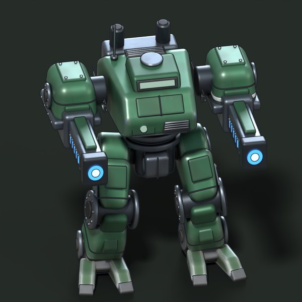
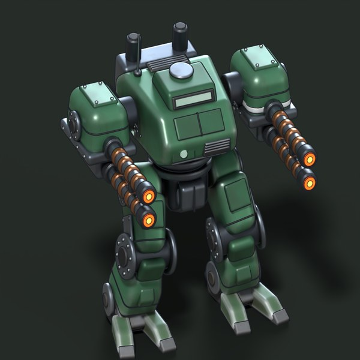
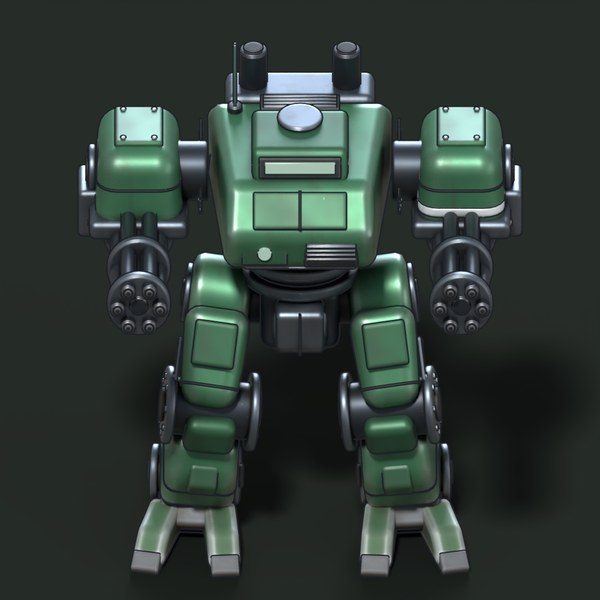
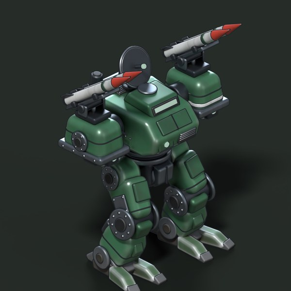
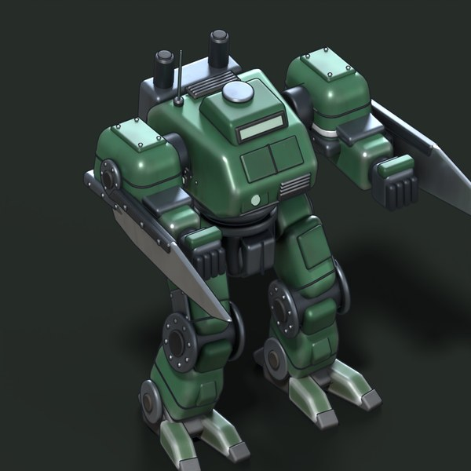
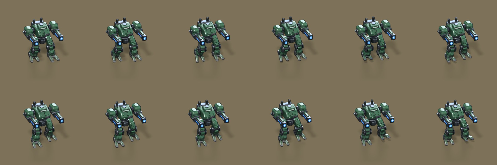
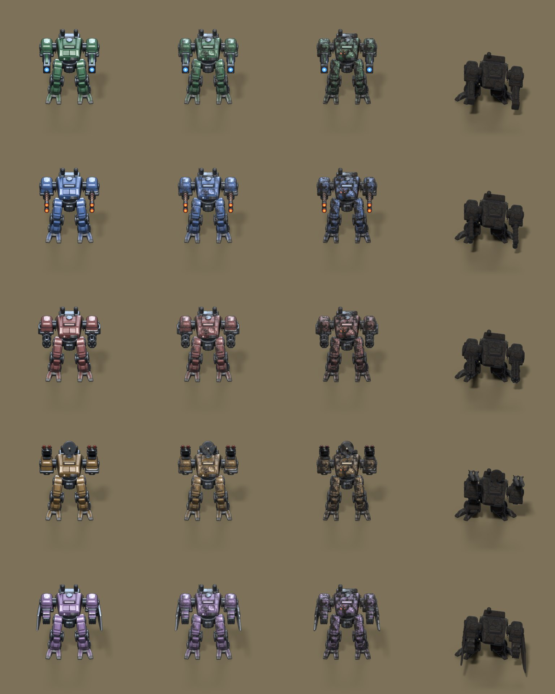

# Walkers — 3D models rendered to sprites

**Status (2026-11-22): approved; re-baked and packed again on 2026-11-21/22** with the new team mask, the tank damage style and a
12-frame walk (the models themselves did not change). Not yet used by the game (see "Open" at the end).
Roster, weapons, ranges and roles: [`../walker-types.md`](../walker-types.md). Rules for every asset: [`../../CLAUDE.md`](../../CLAUDE.md).

| Kodiak | Cougar | Gatling | A.A. Avenger | Achilles |
|---|---|---|---|---|
|  |  |  |  |  |

Walk cycle (Kodiak, direction 2, 12 frames, rebuilt from the packed sheets: legs, upper body with its per-frame offset, shadows):



Checks rebuilt from the packed sheets (all five walkers, team colours, eight directions; then intact, damaged, burning and wreck):




## What is in this folder

| Path | What it is |
|---|---|
| `images/` | Renders and checks shown above (JPG, small copies for the docs) |
| `source/walker_lib.py` | The whole model, renderer and bake functions: **source of truth** (md5 `5f506eb0ac53004153bdc5af2e12978e`) |
| `source/build_walkers.py` | Builds the five models and saves the `.blend` scenes |
| `source/bake_walkers.py` | The bake, run from the command line (see "Bake") |
| `source/blend/walker_<kind>.blend` | One saved Blender scene per walker (Blender 5.3), rebuilt 2026-11-21 |
| `source/tools/pack.py` | Packs the bake frames into sprite sheets + `walkers.json` (Python, numpy, Pillow) |
| `source/tools/compose.py` | Rebuilds units from the sheets the way the game will draw them |
| `source/tools/check_refs.py`, `check_pack.py` | The pack check: reference renders, then the comparison with the sheets (see "Pack check") |
| `source/tools/doc_images.py` | Makes the walk-cycle and check pictures above from the sheets |
| `source/mockup/` | The re-bake mockup of 2026-11-21 (walk at 8 / 12 / 16 frames, damage looks): scripts and page |
| `source/sheets/` | The packed sheets: 43 WebP + `walkers.json`, 82.8 MB for all three resolutions |
| `source/listener.py`, `source/run_job.sh` | The old bridge for running jobs inside an open Blender (see "Bridge"); not needed any more |

**Everything is made inside this folder** (owner, 2026-11-21); the old work folder on the Desktop is no longer used.
**Not in the repo:** the bake frames (`source/bake/`, 4,232 PNG at @4x, 288 MB; git ignores `bake/`, `bake_*/` and `check_refs*/`).
Make them again with `bake_walkers.py`.

**How to run the tools** (PowerShell, from the repo root; Blender is not on the PATH):
```
$blender = "C:\Program Files\Blender Foundation\Blender 5.3\blender.exe"
& $blender -b --python docs\walkers\source\build_walkers.py                 # the five .blend scenes
& $blender -b --python docs\walkers\source\bake_walkers.py -- --out bake    # the bake (output: docs\walkers\source\bake)
docs\tanks\source\.venv\Scripts\python.exe docs\walkers\source\tools\pack.py docs\walkers\source\bake docs\walkers\source\sheets
```
The Python tools use the tank tools' environment (`docs/tanks/source/.venv`: numpy, Pillow). It prints one harmless
`sitecustomize` error line at the start.

## Decisions (owner, 2026-11-19)
- **3D models rendered to sprites, not vector models.** Four VectorUnit attempts were rejected as "not professional": a chunky mech
  needs rounded armour, soft contact shadows and limbs that cross. The game still gets WebP sheets + a team mask, like the tanks.
- The design follows the owner's reference sheet (chunky humanoid mech), not the egg-pod-on-bird-legs of the original manual icons.
- **Paint scheme A:** armour in the team colour.
- **Size approved** (`M2U = 28` model units per metre, shared with the tanks).
- **Detail level:** kept as it is; it is an RTS and units are small on screen.
- **All 32 directions**, with the full walk in every direction.
- **A.A. Avenger:** missiles on the shoulders, 2 per side; a radar dish in the middle of the roof.
- Round 1 notes, all done in round 2: legs closer together, walk cycle reworked.
- The tanks are being rebuilt the same way (3D in Blender) to close the style gap.
- A real 3D game later is possible: these models are a starting point, but would need UV maps / baked textures, merged geometry and
  a skeleton.

## Model (`source/walker_lib.py`)
- Axes: +X forward, Z up, metres. `M2U = 28`. Game y = −Blender y (the game's ground plane is left-handed).
- Kodiak size: 78 long × 85 wide × 94 tall model units (Heavy Panzer hull: 102 × 74 × 35). Feet cover about 55 units (one map cell = 60).
- **Two layers, split by a flat plane at the waist** (`WAIST_Z = 1.95` m): the legs layer is entirely below it and the upper layer
  entirely above it in every walk frame and for all five weapons (gap ≥ 0.5 mm), so upper-over-legs is always the right draw order.
  Weapons must never dip below the waist.
- **Legs** (shared by all five): pelvis with waist ring, hip shells, thigh armour, bolted knee discs, shin armour with a calf piston,
  ankle discs, feet with two toes and a heel. Hips at y = ±0.54 m, ankles at ±0.74 m. Rig: hip → knee → ankle solved per frame
  (`pose_legs(phase)`), feet stay level.
- **Upper layer** (same body for all five): collar, armoured cab leaning 5° forward (visor, glacis plates, chest grille and lamp, side
  light strips), engine pack with two stacks, big rounded shoulder blocks; then the weapon module:
  - Kodiak: boxy plasma cannon per arm, glowing cells and muzzle (fixed blue).
  - Cougar: two long barrels per arm, copper heat bands, glowing magma muzzles (fixed orange).
  - Gatling: motor drum, six barrels with clamp rings (separate spin pivot), ammo box.
  - A.A. Avenger: a twin missile launcher on each shoulder raised 34° (white body, red nose, fins), a radar dish on the roof (static for now),
    arm stubs with a sensor lens.
  - Achilles: armoured forearms, fists, a large cleaver blade along each forearm.
- **Materials:** `paint` / `paint2` (team paint, `unitPaint` rule), `steel`, `dark`, `black`, `bright`, `copper`, `white`, `red`, `emblem`;
  glows `glow` (team light = mix(unitPaint, white, 0.5)), `plasma`, `magma`. One shader does edge wear, cavity grime, streaks, ground dust
  on the feet and damage driven by `DMG` 0–3, in object space so marks never flicker.
- **Damage (tank style, owner 2026-11-21):** 1 = soot, dings, cracks; 2 = large black soot areas, cracked plates, a few embers and
  lost parts (`LOST_AT_BURNING`); 3 = wreck pose (collapsed on folded legs, upper body tilted, charred, all glows off). Flames and
  smoke come from the game's fx sheet. The metal shader is the tanks' `make_metal_t` (`../tanks/source/tank_lib.py`), called through
  `_metal` in `walker_lib.py`; cracks and embers per material are in `DAMAGE_STYLE`. `DAMAGE_LOOK = 'old'` brings back the first look
  (kept only for the mockup).

## Rendering
- **Camera:** true orthographic along (1, −1, 0.75) with `pixel_aspect_x = 1.0672`, which reproduces the game's 2:1 projection exactly
  (screen = a·((x − y), (x + y)/2 − z·4/3), error < 0.01 px). `a` = px per metre = 0.34641 · M2U · resolution multiplier.
- **Light:** sun from L = (0.35, 0.6, 1) in game axes, a cool rim sun and a weak fill; gradient world. Dark outline by Freestyle,
  thickness ≈ a / 70 px (min 0.9). Film transparent, Standard view transform, OptiX GPU, OpenImageDenoise, dark shadow-catcher ground.
- `shoot(path, W, H, a, legs, torso, layer, phase, dmg, mode, zc)` renders one sprite and returns its anchor and the upper body's offset.
  Layers: `legs`, `upper`, `shadow`, `shadow_legs`, `shadow_upper`, `all`, `all+shadow`. Anchor (ground point under the centre) =
  (W/2, H/2 + zc·a·4/3). Directions 0..31 (0 = +x = screen lower-right), `rotation_z = −d·τ/32`.
- **Walk:** 12 frames (`WALK_FRAMES`; 8 until 2026-11-21). Each foot is on the ground 56% of the cycle (`DUTY`). Half step 0.32 m, step lift 0.24 m. The pelvis dips 4 cm with
  both feet down and shifts 5.5 cm over the standing leg. Travel per frame `TRAVEL` = 2·STRIDE / (DUTY · WALK_FRAMES) = 0.0952 m = 2.667 model units = 1.067 game
  units (no foot sliding at that speed); one whole cycle is 1.143 m, the same as before. The upper sprite is baked once per direction and moved by a per-frame, per-direction (x, y) offset (≤ 3 px at @4x).
- **Team mask (new method, as for the tanks):** two renders. A = paint black, team lights off. B = paint pure red, lights pure green,
  both at 20% brightness (`MASK_GAIN = 0.2`), so paint highlights are not cut off at 1.0. `pack.py` computes
  mask = (B − A) / 0.2 in linear light (R = paint, G = lights); the part above 1.0 goes into the base sprite. Colour is added
  **in linear light**:
  `out = toSRGB(toLinear(base) + toLinear(mask.r)·toLinear(paint) + toLinear(mask.g)·toLinear(light))`.
  Adding on sRGB values gives mean 23 / 255, so the game's `TeamSprite` shader needs the linear version for walkers.

## Bake (`source/bake_walkers.py`) — done 2026-11-21/22
- Frame 384 × 384 px at @4x (`BK_MUL = 4`, 38.798 px per metre), anchor (192, 264), 48 samples (shadows 32).
- `blender -b --python bake_walkers.py -- [--out bake] [--only legs,upper,legshadow,extras,wreck] [--kinds ...] [--dirs ...] [--states ...]`.
  Renders skip files that already exist, so a bake can be stopped and started again.
- Files: `legs/s{state}/d{dd}_{pose}_{A|B}.png` (pose `s` = standing, `0`–`11` = walk; states 0 intact, 1 damaged, 2 burning);
  `{kind}/s{state}/d{dd}_{A|B}.png` (upper); `legs/shadow/d{dd}_{pose}.png`; `{kind}/shadow/d{dd}.png`; `{kind}/shadow_upper/d{dd}.png`;
  `{kind}/wreck/d{dd}.png` (8 directions, one layer with its shadow, no team colour); `tables.json` (walk offsets, travel, `walk_frames`,
  `mask_gain`).
- 4,232 renders (legs 2,496, leg shadows 416, per walker 192 upper + 8 wreck + 64 shadows), no failures, 182 minutes on an RTX 3060
  (2.6 s per render on average; it varied between about 1.1 and 3.3 s).
- Shadows are split (legs per pose + upper per direction) so the walk leaves no foot prints.

## Sheets (`source/tools/pack.py <bake dir> <out dir>`) — done 2026-11-22
- Per resolution (@4x, @2x, @1x; downsampled in linear light): `walker-legs`, `walker-legs-dmg`, `walker-<kind>`, `walker-<kind>-dmg`
  (base sprites in the top half, mask in the bottom half: R = paint, G = team lights) and `walker-common` (shadows and wrecks, no mask).
  WebP lossless, at most 4096 px wide, sprites trimmed; a group that does not fit one page gets numbered pages (`walker-common@4x-0.webp` …).
- 2,504 sprites per resolution (1,248 legs, 480 uppers, 736 shadows, 40 wrecks). @1x 13 sheets 6.2 MB · @2x 13 sheets 19.0 MB ·
  @4x 17 sheets 57.6 MB. Packing takes about 6 minutes.
- **`walkers.json`** (`version` 2, `maskGain` 0.2): `frames[res][key] = [sheet index, x, y, w, h, anchorX, anchorY]`; `sheets[res][i] = {file, group, w, h, mask, maskOffsetY}`;
  `walk = {frames (12), travelGameUnitsPerFrame, travelModelUnitsPerFrame, upperOffset1x[dir][frame]}` (direction keys are strings).
  Keys: `legs/s{state}/d{dd}/{pose}`, `{kind}/s{state}/d{dd}`, `shadow/legs/d{dd}/{pose}`, `shadow/{kind}/d{dd}`,
  `shadow_upper/{kind}/d{dd}`, `wreck/{kind}/d{dd}`.
- **Draw order for one walker:** shadows → legs (at the unit position) → upper (unit position + upperOffset × resolution).
  Blend a unit's shadows with "max" so they do not darken twice.

## Pack check (`source/tools/check_refs.py`, `check_pack.py`) — done 2026-11-22
- `blender -b --python tools/check_refs.py -- --out check_refs --kinds kodiak,cougar,gatling,avenger,achilles --dirs 2,21 --poses s,3,9 --states 0,1,2`
  renders the whole walker and each layer alone in the real team colour (270 renders, about 10 minutes); then
  `python tools/check_pack.py sheets check_refs check_pack.jpg` rebuilds the same cases from the sheets and prints the mean
  difference on the walker (0..255).
- **Result for the sheets of 2026-11-22 (90 cases, all five walkers): layers 0.4 to 3.4, whole walker 3.0 to 11.3.**
  A layer above about 6 would mean a fault in the mask or the pack; there is none. (The 2026-11-19 sheets: layers 2.2 and 3.5.)
- The whole-walker number is higher because the layers are lit one at a time: the upper body's shade on the hips and thighs is
  missing in the sheets ("Open", point 3), and the upper sprite is a standing render moved by the walk offset. It is highest seen
  from behind in mid-step (direction 21, walk frame 3: 10.0 to 11.3 for all five), where most of the hips show.

## Bridge (old way of running jobs, not needed any more)
The first bake (2026-11-19) ran as jobs inside an open Blender through `listener.py` and `run_job.sh`. Since 2026-11-21 everything runs
from the command line (`blender -b --python ...`), so the bridge is kept only for reference. To use it: run
`exec(open(r"D:\Games\steel-meridian\docs\walkers\source\listener.py").read())` once in Blender's Python console; it runs
`jobs/*.py` one at a time and writes `jobs/<name>.done` or `.fail`. The first GPU render after a fresh install takes about 5 minutes
(kernel build). The library also runs in a cloud workspace (`pip install bpy==5.3.0`, CPU only, about 20× slower) for build checks.

## Open
1. **Game side:** a `TeamSprite` shader variant that adds in linear light, a walker unit class (legs + upper + shadows, walk frames
   tied to distance travelled), and a viewer/demo. Walkers must appear at their true design scale and walk smoothly. This comes
   after the structures and the map (order of work in `CLAUDE.md`).
2. Not made yet: firing effects, Gatling spin frames, the Achilles strike, a spinning radar.
3. Known rough spots: at game size "damaged" is hard to tell from intact (needs the fx smoke); **the upper body casts no shade on the
   legs** (the layers are lit one at a time). The tanks solve the same thing with a plain stand-in for the turret; doing that here
   means baking the legs again (2,496 renders). **Owner, 2026-11-22: keep it as it is.**
4. Later: the Walker Factory building.

## Done in the re-bake of 2026-11-21/22 (owner's decisions of 2026-11-20 and 2026-11-21)
- The damaged and burning look follows the tank damage style (smoky tint, more black soot and cracked plates, less orange). Chosen
  from the mockup as "New (tank style)"; a smokier variant was shown and turned down.
- The new team-mask method (B render at 20% brightness, highlights kept).
- The walk has 12 frames instead of 8 (chosen from the mockup, 8 against 12 against 16:
  https://claude.ai/artifact/Xc7WQ415pYMC6XLZi4YRDD; scripts and page in `source/mockup/`).
- The models were not remodelled. `tools/compose.py` had a fault (it skipped the team paint rule `paint_of`, so its paint was too
  bright); fixed.
